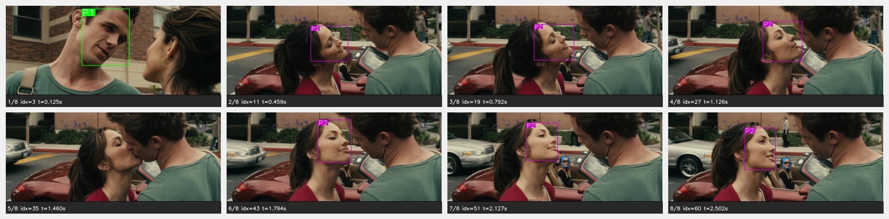

<div align="center">

# BAC: Beyond Anonymous Captions

**Grounding character identity in video captioning and question answering**

*Qwen3-VL + LoRA · name-aware captions · identity QA*

<!-- TODO: replace with final paper link once public -->
[](#citation)
[](https://huggingface.co/datasets/momentslab/beyond-anonymous-captions)
[](https://huggingface.co/momentslab/beyond-anonymous-captions)
[](LICENSE)

[Moments Lab](https://www.momentslab.com)

</div>

---

## Overview

**BAC** (*Beyond Anonymous Captions*) has the code, data and LoRA adapters for **identity-grounded video understanding**. Given sampled frames from a movie shot plus face-grounded identities, a Qwen3-VL model:

- **Captioning (`cap`):** writes a caption that names each grounded person and adds a short visual description of them.
- **Identity QA (`qa`):** answers questions about *who* is doing *what* in the shot.

<p align="center">
  
</p>

**Identity mapping:** $\color{green}\textbf{P1}$ ↔ $\color{green}\text{Cam Gigandet}$ · $\color{magenta}\textbf{P2}$ ↔ $\color{magenta}\text{Minka Kelly}$ · $\color{blue}\textbf{P3}$ ↔ $\color{blue}\text{Leighton Meester}$

**Caption:** $\color{green}\text{Cam Gigandet}$, in a green shirt, and $\color{magenta}\text{Minka Kelly}$, in a red top, stand close together and share a kiss while $\color{blue}\text{Leighton Meester}$, in the car, watches.

**Person-centric QA:**

| Question | Type | Answer |
|---|---|---|
| *Who is in the car?* | Position | $\color{blue}\text{Leighton Meester}$ |
| *Who is kissing* $\color{magenta}\text{Minka Kelly?}$ | Interaction | $\color{green}\text{Cam Gigandet}$ |
| *Who is wearing a green shirt?* | Appearance | $\color{green}\text{Cam Gigandet}$ |
| *Who is wearing a red top?* | Appearance | $\color{magenta}\text{Minka Kelly}$ |

## Release contents

| Resource | Link | Description |
|---|---|---|
| Code | this repo | Inference, LoRA fine-tuning, data prep |
| ⭐ Dataset: benchmark | [`shot_captions/test`](https://huggingface.co/datasets/momentslab/beyond-anonymous-captions/viewer/benchmark/test) | **Manually annotated.** 750 shots · 12 movies · 8 frames per shot · face boxes with actor/character · caption · 4 identity QA per shot (3,000) |
| Dataset: train | [`shot_captions/train`](https://huggingface.co/datasets/momentslab/beyond-anonymous-captions/viewer/train/train) | 31,935 shots · 72 movies · 8 frames per shot · face boxes with actor/character · caption |
| Dataset: face tracks | [`clip_faces`](https://huggingface.co/datasets/momentslab/beyond-anonymous-captions/viewer/clip_faces/lsmdc) | 33,996 clips (LSMDC + MPII-MD) · face boxes with actor/character and identification score on **every frame** · no captions, no QA |
| Models: LoRA adapters | [`momentslab/beyond-anonymous-captions`](https://huggingface.co/momentslab/beyond-anonymous-captions) | One repo, one subfolder per size: [`2b/`](https://huggingface.co/momentslab/beyond-anonymous-captions/tree/main/2b), [`4b/`](https://huggingface.co/momentslab/beyond-anonymous-captions/tree/main/4b), [`8b/`](https://huggingface.co/momentslab/beyond-anonymous-captions/tree/main/8b) for Qwen3-VL-2B/4B/8B-Instruct |

## Repository structure

```
.
├── scripts/
│   ├── run.py                 # inference: identity QA or captioning
│   ├── train.py               # LoRA fine-tuning
│   ├── prepare_manifests.py   # build finetune manifests from shot JSONs
│   ├── unpack_data.py         # unpack the HF archives into per-file JSONs
│   └── data_curation/         # scripts used to build/clean the released annotations
├── src/
│   ├── config.py              # model presets, generation + LoRA hyperparameters
│   ├── prompts.py             # captioning / QA prompt templates
│   ├── extract_shot_frames.py # extract the 8 frames per shot from source videos
│   ├── render_clip_video.py   # draw clip_faces tracks on the full clips (mp4)
│   ├── grounding/             # prompt building, frame annotation, batched generation
│   ├── finetune/              # dataset, collator, LoRA setup
│   └── utils/                 # bbox, names, QA parsing, text cleanup
├── data/                      # ← downloaded from Hugging Face (not in git)
├── models/lora/{2b,4b,8b}/    # ← downloaded from Hugging Face (not in git)
└── requirements.txt
```

## Installation

```bash
git clone https://github.com/momentslab/beyond-anonymous-captions.git
```

```bash
cd beyond-anonymous-captions && python -m venv .venv && source .venv/bin/activate
```

```bash
pip install -r requirements.txt
```

You need a CUDA GPU with bf16 support. The defaults are tuned for 2B at batch 8 and 4B/8B at batch 2.

## Getting the data

### 1. Annotations (Hugging Face)

The dataset is **gated**. Request access on the [dataset page](https://huggingface.co/datasets/momentslab/beyond-anonymous-captions) and accept the research-only terms, then:

```bash
hf auth login
```

```bash
hf download momentslab/beyond-anonymous-captions --repo-type dataset --local-dir data
```

```bash
python scripts/unpack_data.py
```

### 2. Videos (from LSMDC v2, not redistributed)

We don't redistribute any video or frames. To get the source clips:

1. **Ask for permission:** request access to the [MPII Movie Description dataset (MPII-MD)](https://moviedescreg.mpi-inf.mpg.de/register.php), as described in the *Dataset download* section of the LSMDC page. Once approved, you receive a username/password, and the data is used under LSMDC's own license agreement.
2. **Download the video clips** from the **LSMDC v2** section of the [LSMDC download page](https://sites.google.com/site/describingmovies/download/), using the sub-item *"Download script for the video clips"*, with the username/password you get from step 1.

Put the clips under `./data/videos/`, keeping the LSMDC v2 layout (one folder per source, one folder per movie):

```
data/videos/
├── lsmdc/
│   └── 3001_21_JUMP_STREET/
│       └── 3001_21_JUMP_STREET_01.16.35.129-01.16.37.251.avi
└── mpiimd/
    └── 0001_American_Beauty/
        └── 0001_American_Beauty_00.00.51.926-00.00.54.129.avi
```

This matches the `video` path stored in every annotation file (`data/videos/{lsmdc,mpiimd}/{movie}/{clip}.avi`).

### 3. Data layout

After steps 1 and 2 (and `unpack_data.py`), `data/` looks like this:

```
data/
├── shot_captions/
│   ├── test/{movie}/{clip}/shot{N}/input_sequence.json    # BAC benchmark
│   └── train/{movie}/{clip}/shot{N}/input_sequence.json   # training set
├── clip_faces/{lsmdc,mpiimd}/{MOVIE}/{clip}.json          # face tracks on every frame
├── train_test_split/{train,test}.txt                      # movie-level split
└── videos/{lsmdc,mpiimd}/{movie}/{clip}.avi               # from LSMDC v2 (step 2)
```

Train and benchmark are **disjoint at the movie level**. Steps 4 and 5 below are independent of each other: run the one(s) you need. If your videos live somewhere other than `data/videos/`, pass `--videos-root /path/to/videos` (or set `LSMDC_VIDEOS_ROOT`) to either script.

### 4. Extract the 8 frames per shot (`shot_captions`)

Needed for inference and training.

```bash
python src/extract_shot_frames.py --split test
```

```bash
python src/extract_shot_frames.py --split train
```

For every shot, this reads the 8 frame indices from `input_sequence.json`, grabs those frames from the source clip and writes them next to the JSON:

```
shot_captions/{split}/{movie}/{clip}/shot{N}/frames/
├── frame{X}.jpg        # raw frame, X = frame index in the clip (8 per shot)
├── frame{X}_bbox.jpg   # same frame with each face box labelled "Actor Name score"
└── sequence.jpg        # the 8 annotated frames in one 2×4 grid (like the overview figure)
```

Shots that already have a `sequence.jpg` are skipped, so you can stop and resume. Use `--clips <clip names>` to process only some clips, or `--output-dir DIR` to write the frames to `DIR/{movie}/{clip}/shot{N}/frames/` instead.

### 5. Render face tracks on the clips (`clip_faces`, optional)

To see the `clip_faces` annotations on the videos, draw them on every frame of a clip:

```bash
python src/render_clip_video.py --clip 3001_21_JUMP_STREET_01.16.35.129-01.16.37.251
```

```bash
python src/render_clip_video.py --dataset lsmdc --movie 21_JUMP_STREET --limit 3
```

Output: one video per clip at `output/videos/clip_faces/{MOVIE}/{clip}_bbox.mp4` (change it with `--output-dir`).

- The **full clip**, at the source resolution and frame rate (every frame, not just 8).
- Every face listed in the JSON is boxed and labelled **"Character Name score"**, one color per character.

`--movie` takes the folder name used in `clip_faces` (e.g. `21_JUMP_STREET`, no numeric prefix). Without `--clip`, `--dataset` or `--movie`, it renders all 33,996 clips.

## The BAC benchmark

`shot_captions/test` is the **reference benchmark** for identity-aware captioning and identity QA. Each shot has 8 frames with face boxes, actors and characters; one manually annotated caption; and 4 *who* questions (appearance, action, interaction, position, object, posture). Each answer is an actor name, or `UNIDENTIFIED` when the person isn't one of the identified characters.

```json
{
  "caption": "Elliot Page, wearing a patterned collared shirt, receives a folded drawing passed across desks in a classroom, unfolds it, and smiles while reading the note.",
  "questions": [
    {"id": "Q1", "type": "appearance",  "question": "Who is wearing a patterned collared shirt?", "answer": "Elliot Page", "ok": true},
    {"id": "Q4", "type": "interaction", "question": "Who passes the folded drawing to Elliot Page?", "answer": "UNIDENTIFIED", "ok": true}
  ]
}
```

## Annotation fields

**`shot_captions/*/input_sequence.json`**: one shot, 8 sampled frames. The benchmark files are the reference schema; training files have the same fields without `questions`.

| Field | Description |
|---|---|
| `movie`, `source_clip`, `dataset`, `video` | Source identifiers (`dataset` = `lsmdc` or `mpiimd`) |
| `shot_index`, `shot_start_second`, `shot_end_second` | Shot position inside the clip |
| `fps`, `frame_width`, `frame_height`, `total_video_frames` | Source video metadata |
| `caption` | Caption naming every identified person |
| `questions[]` | *Benchmark only.* `id`, `type`, `question`, `answer`, `ok` |
| `frames[]` | `frame_order`, `frame_index`, `timestamp`, `persons[]` → `actor`, `character`, `bbox` (face, `[x1, y1, x2, y2]` px), `track_id`, `score` |

**`clip_faces/*.json`**: face tracks on every frame of the clip (`sampled_frames[].faces[]` → `track_id`, `bbox`, `name` (character), `actor`, `score`).

**`score` is the identification confidence**: how sure the pipeline is that the face belongs to that character/actor. Higher means more confident. Scores range from 0.30 (the minimum kept) to about 0.97. Raise the cut-off to trade coverage for precision.

## Model weights

All three adapters live in one repo, [`momentslab/beyond-anonymous-captions`](https://huggingface.co/momentslab/beyond-anonymous-captions), with one subfolder per size:

```bash
hf download momentslab/beyond-anonymous-captions --include "8b/*" --local-dir models/lora
```

This puts the adapter in `models/lora/8b/`. Swap `8b` for `2b` or `4b`, or drop `--include` to get all three. You can also skip this step: `--lora auto` in `run.py` uses `models/lora/{size}` and downloads the adapter from the Hub if it's missing.

To use an adapter directly in Python:

```python
from peft import PeftModel
from transformers import AutoProcessor, Qwen3VLForConditionalGeneration

base_id = "Qwen/Qwen3-VL-8B-Instruct"
base = Qwen3VLForConditionalGeneration.from_pretrained(base_id, torch_dtype="bfloat16", device_map="auto")
model = PeftModel.from_pretrained(base, "momentslab/beyond-anonymous-captions", subfolder="8b")
processor = AutoProcessor.from_pretrained(base_id)
```

## Inference

Run on the BAC benchmark (`data/shot_captions/test`):

```bash
python scripts/run.py cap --size 8b --lora auto
```

```bash
python scripts/run.py qa --size 8b --lora auto
```

| Flag | Meaning |
|---|---|
| `qa` / `cap` | Task: identity QA or captioning |
| `--size {2b,4b,8b}` | Qwen3-VL base size |
| `--lora auto\|PATH` | `auto` = `models/lora/{size}`; omit for the zero-shot base model |
| `--limit N` | First N shots only (quick test) |
| `--resume` | Skip shots already done |
| `--visualize` | Save annotated frames + sequence grid |
| `--output_dir` | Default: `output/Qwen3_{size}[_lora]_{task}/test` |

Outputs are written per shot as `result_caption_coord_face.json` / `result_identity_qa_coord_face.json`. QA accuracy is aggregated automatically.

## Training

`train.py` takes the **Qwen3-VL Instruct base model** of the size you choose and fine-tunes it with **LoRA** on the BAC training set (`data/shot_captions/train`, 8 frames per shot, see step 4 of [Getting the data](#getting-the-data)):

| `--size` | Base model |
|---|---|
| `2b` | [`Qwen/Qwen3-VL-2B-Instruct`](https://huggingface.co/Qwen/Qwen3-VL-2B-Instruct) |
| `4b` | [`Qwen/Qwen3-VL-4B-Instruct`](https://huggingface.co/Qwen/Qwen3-VL-4B-Instruct) |
| `8b` | [`Qwen/Qwen3-VL-8B-Instruct`](https://huggingface.co/Qwen/Qwen3-VL-8B-Instruct) |

The base weights are downloaded from Hugging Face and kept frozen; only the small LoRA adapter is trained.

```bash
python scripts/train.py --size 8b
```

To hold out 10 % of the training shots for evaluation and keep the best checkpoint:

```bash
python scripts/train.py --size 2b --eval --eval_ratio 0.1
```

Training manifests are built from `data/shot_captions/train` on the first run (or with `--prepare`). Default hyperparameters (`src/config.py`):

| | |
|---|---|
| LoRA | r = 16, α = 32, dropout = 0.05, all attention + MLP projections |
| Optimizer | AdamW, lr = 5e-5, cosine, warmup 3 %, grad-clip 1.0 |
| Batch | 1 × 8 grad-accum, bf16, gradient checkpointing |
| Schedule | 1 epoch, seed 42 |
| Frames | 8 per shot, 131k–524k pixels per image |

Outputs go to `models/finetune/{size}/` (change with `--output_dir`):

- `final/`: the trained LoRA adapter and processor
- `best/`: the best checkpoint by eval loss (only with `--eval`)
- `loss_curves.png`, `train_log_history.json`, `train_config.json`, `logs/` (TensorBoard)

Run inference with your own adapter:

```bash
python scripts/run.py cap --size 8b --lora models/finetune/8b/final
```

## Results

<!-- TODO: copy final numbers from the paper. Do not fill in from memory. -->
See the paper for captioning and identity-QA results.

## License & intended use

**Research use only. Commercial use is not permitted.**

- **Code, annotations and LoRA weights:** [CC BY-NC 4.0](LICENSE), released for non-commercial research.
- **Source videos:** [LSMDC v2](https://sites.google.com/site/describingmovies/download/) (LSMDC + MPII-MD clips), under their original license agreements. Nothing from them is redistributed here.
- **Base models:** [Qwen3-VL](https://huggingface.co/Qwen) (Apache-2.0).

The annotations include the names of publicly credited actors and characters, tied to face bounding boxes in commercial films. Don't use this release to identify people outside that context, for surveillance, or to build face-recognition systems.

## Citation

```bibtex
@misc{bac2026,
  title  = {BAC: Beyond Anonymous Captions: Grounding Character Identity in Video Captioning and Question Answering},
  author = {TODO},
  year   = {2026},
  note   = {TODO: venue / arXiv id}
}
```

## Acknowledgements

Built on [Qwen3-VL](https://github.com/QwenLM/Qwen3-VL), [PEFT](https://github.com/huggingface/peft) and the [LSMDC v2](https://sites.google.com/site/describingmovies/download/) data.
